# Product Requirements Document (PRD)
## Project: Prompt By Niti — AI-Powered Prompt Marketplace, Generation Engine, and Content Agent Sandbox

---

## Contents
1. **Product Overview**
   - 1.1 Strategic Vision & Mission
   - 1.2 Core Value Proposition
   - 1.3 Target Audience & Positioning
   - 1.4 Product Scope & Boundaries
2. **Objectives and Goals**
   - 2.1 Business & Platform Objectives
   - 2.2 Technical & Engineering Objectives
   - 2.3 Key Performance Indicator (KPI) Targets
   - 2.4 Educational & Project Alignment Goals
3. **Target Users**
   - 3.1 Persona 1: The AI Art & Code Seller (Prompt Creator)
   - 3.2 Persona 2: The Professional Prompt Buyer (Developer/Agency Marketer)
   - 3.3 Persona 3: The Social Content Creator (YouTube Strategist)
   - 3.4 Persona 4: The System Administrator (SysAdmin Moderator)
   - 3.5 Detailed User Scenarios and Journey Walkthroughs
4. **Actual Problem Statement**
   - 4.1 Fragmentation and Friction in Prompt Optimization
   - 4.2 Quality Gaps and Trust Deficits in Public Repositories
   - 4.3 Loss of Continuity in Contextual Agent Chats
   - 4.4 Cost and Scaling Vulnerabilities of AI Integrations
5. **Proposed Solution**
   - 5.1 Architecture Overview
   - 5.2 Decoupled Functional Modules
   - 5.3 Technical Optimization Pipeline
6. **Features**
   - 6.1 Secure Authentication and Session Management
   - 6.2 Real-Time Prompt Generation & Automated Optimization Engine
   - 6.3 Creator & Buyer Marketplace (Stripe/Razorpay Transaction Simulation)
   - 6.4 YouTube Content Creator AI Agent Sandbox (Memory & Workflows)
   - 6.5 Pinned Announcements & Community Lounge Polling Chat
   - 6.6 System Parameters & Admin Control Center
   - 6.7 Premium Canvas Visuals: The Quantum Reactor
7. **The Three Core AI Reference Engines**
   - 7.1 Image Reference Consistency Engine (Style & Character Coherence)
   - 7.2 Video Reference Consistency Engine (Motion & Loop Coherence)
   - 7.3 Text and Agent Reference Consistency Engine (Context & Persona Coherence)
8. **AI Agents Architecture & Specifications**
   - 8.1 YouTube Content Strategist Agent
   - 8.2 Customer Support AI Agent
   - 8.3 Research & Synthesis Agent
   - 8.4 Modular Coding Agent
   - 8.5 Process Automation Agent
9. **Use Flow**
   - 9.1 Primary Flow — Buyer Journey (Browse, Purchase, Download, Run)
   - 9.2 Secondary Flow — YouTube Strategist Onboarding & Script Generation
   - 9.3 Tertiary Flow — Admin/Seller Operations (Prompts, Model Adjustments, Analytics)
10. **Functional Requirements**
    - 10.1 Detailed Frontend Page Routing and Components Layout
    - 10.2 Backend REST API Endpoints and Controllers
    - 10.3 Mongoose Schemas and Data Models
    - 10.4 Programmatic Variable Reduction and Subcategory Rules
    - 10.5 Detailed QA Test Suite & Manual Test Cases
11. **Non-Functional Requirements**
    - 11.1 Performance
    - 11.2 Security
    - 11.3 Reliability
    - 11.4 Usability
    - 11.5 Maintainability
    - 11.6 Portability
12. **Tech Stack**
    - 12.1 Technology Directory
    - 12.2 Project Directory Structures
13. **Risk Assessment & Mitigation**
14. **References & Official Documentation**
    - 14.1 Frontend Technologies & Libraries
    - 14.2 Backend Technologies & Frameworks
    - 14.3 AI Models & Third-Party Cloud SDKs
    - 14.4 Security, Utility & Infrastructure

---

## 1. Product Overview

### 1.1 Strategic Vision & Mission
**Prompt By Niti** is an enterprise-grade web application engineered to bridge the gap between AI prompt engineering, prompt monetization, and active AI agent simulation. The platform's strategic vision is to create a complete ecosystem where developers, prompt creators, digital marketers, and content creators can draft, optimize, test, purchase, sell, and deploy high-quality prompts. The mission is to simplify prompt utilization and enable creators to extract actual commercial value from LLMs.

### 1.2 Core Value Proposition
Prompt By Niti differentiates itself from static prompt catalogs by offering a dynamic utility pipeline:
1. **Dynamic Prompt Compiler:** Automatically expands simple user inputs into structured prompts containing custom variables (e.g. `[industry]`, `[target_audience]`), based on domain-specific rules.
2. **Dual-Portal Marketplace:** Allows prompt creators (sellers) to list verified prompt templates and buyers to license, run, rate, and review these items.
3. **YouTube Agent Workspace:** An interactive AI manager workspace featuring persistent memory profiles (`YoutubeAgentMemory`) and workflows (Script Outliner, SEO Tagger, Posting Scheduler) to help creators grow their channels.
4. **Community Lounge:** Renders real-time community chat logs (using dynamic polling updates) and admin notifications to drive collaboration.
5. **Interactive UI Particles:** Features a canvas-based orbital physics engine (the Quantum Reactor) that visually reflects the loading and fusion states of prompt optimization.

### 1.3 Target Audience & Positioning
The platform is positioned at the intersection of AI Developer Tools, Creator Economy Utilities, and Peer-to-Peer digital marketplaces. It is targeted at:
* **Freelance Prompt Engineers:** Looking to build portfolio pages, share prompt outcomes, and earn wallet tokens.
* **Agencies and Marketers:** Looking for pre-tested copywriting, image, and video prompt templates.
* **YouTube Content Creators:** Looking to streamline video outlines, script writing, description tags, and visual assets within a single workspace.

### 1.4 Product Scope & Boundaries
The platform supports prompt outputs in three formats: **Text** (e.g. coding instructions, copywriting), **Image** (e.g. Midjourney style formulas, Flux parameters), and **Video** (e.g. Sora camera motion settings). The product boundaries are strictly defined: prompt generations are executed against registered LLM endpoints, while final image and video outputs rely on external generation tools. The platform handles prompt construction, parameter validation, performance analytics, and community sharing.

---

## 2. Objectives and Goals

### 2.1 Business & Platform Objectives
* **Monetize Prompt Engineering:** Enable prompt creators to gain secondary revenue streams by listing verified prompt templates in an open marketplace.
* **Streamline Content Workflows:** Provide YouTube creators with an AI strategist agent that reduces script and visual asset generation cycles from days to minutes.
* **Establish Trust Standards:** Implement a robust review and transaction audit logging system to guarantee that buyers license high-quality, verified prompts.

### 2.2 Technical & Engineering Objectives
* **Dynamic Variable Control:** Programmatically parse and restrict bracketed variables (e.g., `{{brand_name}}`) in prompt templates to prevent model hallucination and payload blow-up.
* **High-Performance Canvas Rendering:** Ensure smooth UI micro-animations and physics simulations running at a consistent 60 frames per second (FPS) without blocking the main React thread.
* **LLM Client Resilience:** Implement an automated model fallback chain to guarantee 99.9% uptime for AI generation services.
* **Secure Architecture:** Enforce strict JSON Web Token (JWT) session validation, password hashing via bcrypt, CORS control, and input sanitization to protect user credentials and transactional data.

### 2.3 Key Performance Indicator (KPI) Targets
* **Server Latency:** Keep API routes responsive under 200ms (excluding external AI generation).
* **Gemini API Execution Speed:** Keep average optimization run times under 3.5 seconds.
* **Visual Rendering stability:** Maintain canvas orbital simulations at a stable 60 FPS without frame drops on standard consumer hardware.
* **Payment Processing Speed:** Execute Razorpay order creation and signature validation in under 500ms.

### 2.4 Educational & Project Alignment Goals
* Demonstrate a decoupled, modular MERN architecture.
* Showcase advanced prompt engineering techniques, showing how system prompts, variable interpolation, and subcategory-specific constraints shape LLM outputs.
* Build a state-driven React single-page application (SPA) using the Context API for global state management and persistent local storage caching.

---

## 3. Target Users

The user base of Prompt By Niti is categorized into four primary personas:

### 3.1 Persona 1: The AI Art & Code Seller (Prompt Creator)
* **Demographics:** Freelance prompt engineers, copywriters, and AI research hobbyists.
* **Needs:** A platform to showcase, test, and monetize specialized prompts.
* **Primary Interactions:** Uses the `/sell` page to publish new templates, manages listings via the Seller Dashboard, and tracks credit payouts.

### 3.2 Persona 2: The Practical Prompt Buyer (Developer/Agency Marketer)
* **Demographics:** Independent developers, marketing specialists, and agency owners.
* **Needs:** A reliable prompt library with pre-tested variables for automation workflows.
* **Primary Interactions:** Uses the masonry feed to search templates, preview outputs, buy templates, test them with custom variables, and write reviews.

### 3.3 Persona 3: The Social Content Creator (YouTube Strategist)
* **Demographics:** YouTubers, channel managers, or video marketers.
* **Needs:** Consistent content ideation, scripting, SEO tag generation, and posting schedule coordination.
* **Primary Interactions:** Completes the Onboarding Wizard to save channel configurations, uses the Agent Sandbox chat panel, runs outline templates, and saves generated scripts.

### 3.4 Persona 4: The System Administrator (SysAdmin Moderator)
* **Demographics:** Platform owners, system moderators, and developer leads.
* **Primary Interactions:** Uses `/admin-lab` to configure Gemini keys, toggle active models, approve/reject prompt listings, and process withdrawals.

### 3.5 Detailed User Scenarios and Journey Walkthroughs
* **Scenario 1 (Creator Scripting Flow):** A content creator wants to draft a script for their next video. They open `/agent-sandbox`, complete the onboarding form, navigate to "Chat", and enter their topic. The agent processes the prompt, referencing their channel profile, and returns a structured outline. The user copies the outline and schedules the video.
* **Scenario 2 (Developer Integration Flow):** A developer is building a coding assistant. They browse the feed, click on a coding template, enter custom variable values (e.g., `{{language}}`), and click "Run Prompt". The system processes the request, displays token usage and execution speed, and returns a clean code output.

---

## 4. Actual Problem Statement

### 4.1 Fragmentation and Friction in Prompt Optimization
The current prompt ecosystem is highly fragmented. Copying prompts from community groups and pasting them into individual LLM interfaces requires manual editing of variable parameters. This approach lacks persistent storage, variables tracking, and version control.

### 4.2 Quality Gaps and Trust Deficits in Public Repositories
Buyers struggle to verify if a paid prompt template produces consistent results. The lack of standard rating systems, review comments, and verified output screenshots makes purchasing prompts a risky process.

### 4.3 Loss of Continuity in Contextual Agent Chats
In standard chat interfaces, the model loses context as the conversation grows. This requires users to re-explain their niche, target audience, and brand guidelines, slowing down content creation workflows.

### 4.4 Cost and Scaling Vulnerabilities of AI Integrations
Calling LLM endpoints without rate limits, input validations, or fallback keys can lead to high operating costs and service downtime, highlighting the need for a standardized prompt validator.

---

## 5. Proposed Solution

**Prompt By Niti** resolves these issues by consolidating creation, evaluation, transaction logging, and execution into a single web application:

```
+---------------------------------------------------------------------------------+
|                                 Platform Modules                                |
+---------------------------------------------------------------------------------+
| 1. Authentication Layer  -> Secure Signup, Login, Email OTP, OAuth             |
| 2. Optimization Engine   -> Rules-based template builder, variable constrains   |
| 3. Marketplace Hub       -> Pinterest Masonry grid, review logs, mock checkout  |
| 4. AI Agent Sandbox      -> YouTube Channel Memory profiles, chat, workflows    |
| 5. Collaborative Lounge  -> Live chat, admin announcements, system logs         |
| 6. Admin Lab             -> Settings controller, model switches, analytics      |
| 7. Quantum Reactor       -> Canvas-based physics reactor for visual feedback    |
+---------------------------------------------------------------------------------+
```

### 5.1 Architecture Overview
The platform runs a React single-page application communicating with an Express API and a MongoDB database. A central React context handles state variables (user profile, credits, cart items, favorites, and canvas states).

### 5.2 Decoupled Functional Modules
* **Automated Optimization Engine:** Users submit basic prompt text, select a category, and the system matches it with pre-defined subcategory rules to generate an optimized prompt template.
* **Context-Aware Content Sandbox:** A dedicated YouTube AI agent workspace. Through an onboarding wizard, the user inputs their channel details (niche, brand colors, tone, goals). This is saved as a persistent `YoutubeAgentMemory` document in MongoDB. The agent uses this long-term context in every chat and workflow session (script outline, tags, video planner).
* **Vibrant Peer-to-Peer Marketplace:** Prompt creators list templates specifying descriptive variables (e.g., `[industry]`, `[target_audience]`). Buyers purchase prompts using simulated transactions (linked to Razorpay mock scripts), immediately unlocking them in their "Library" page where they can edit, run, and rate the prompt.
* **Community-Led Learning:** Real-time message exchanges in the Lounge page let users discuss prompt results, share insights, and view global activity logs of new prompt listings.

### 5.3 Technical Optimization Pipeline
When a user submits a prompt optimization request, the payload is routed through a series of validation and transformation steps:

```
[User Text Input] ---> [Category Check] ---> [Rule Lookup in rules.js]
                                                      |
                                                      v
[Optimized Output] <--- [Gemini Generation] <--- [Variable Parser]
```

---

## 6. Features

### 6.1 Secure Authentication and Session Management
* **Secure Registry:** The `/signup` page takes Username, Email, Password, Social Links (optional), and registers the user. Password strings are encrypted on the backend using `bcryptjs` before insertion into the MongoDB database.
* **Token-Based Sessions:** Successful `/login` returns a secure, signed JSON Web Token (JWT) that is cached on the client side in local storage (`promptbyniti_token`).
* **Protected Routes:** Frontend route guards (`ProtectedRoute`, `AdminRoute`, `GuestRoute`) intercept requests, verify session existence, and decode roles to prevent unauthorized entry to pages like `/generate`, `/sell`, `/admin-lab`, or `/library`.

### 6.2 Real-Time Prompt Generation & Automated Optimization Engine
* **Rule-Based Expansion:** When a user types a simple instruction, the generator engine analyzes the selected category. The backend applies detailed instructions from the `rules.js` registry to generate a highly detailed prompt template.
* **Variable Extractor & Limiter:** The system programmatically parses brackets (`[variable]`) to identify custom fields. If the number of variables exceeds the system-configured limit (e.g., 5 variables), the backend running `limitVariables` resolves extra variables with their context values to keep prompt execution focused.
* **Real-time Executions:** Users can run generated prompts by providing values for the extracted variables. The system makes an authorized API call to Google Gemini, streams the output, and highlights performance stats (e.g., response time, character count).

### 6.3 Creator & Buyer Marketplace (Stripe/Razorpay Transaction Simulation)
* **Masonry Landing Feed:** The marketplace displays prompts in an interactive masonry-style layout using `PinterestCard` and `PromptThumbnail` components. Items are sorted deterministically using a seeded shuffle algorithm so that components remain stable during navigation.
* **License Purchase Flow:** When a user clicks "Buy Prompt" on a listing, it triggers a mock transaction script integrated with simulated Razorpay API configurations. On success, the transaction is logged in the `Transaction` schema, and the prompt is cloned into the buyer's private `Library`.
* **Reviews and Ratings:** Licensed users can leave detailed textual feedback and star ratings (0 to 5, rendered dynamically). Ratings are aggregated on the backend to display the prompt's trust score.

```
       [Seller] ---> Create Listing ---> Approved by Admin ---> Listed in Marketplace
                                                                      |
                                                                      v
[Buyer] ---> Library Page <--- (Transaction Log) <--- Purchase <--- [Masonry Feed]
```

### 6.4 YouTube Content Creator AI Agent Sandbox (Memory & Workflows)
* **Onboarding Wizard:** A step-by-step form capturing channel name, audience profile, upload frequency, tone, brand colors, and competitor channels.
* **Agent Memory Layer:** The collected data is stored in the `YoutubeAgentMemory` model.
* **Workflow Automation Tabs:**
  * **Video Outliner:** Generates a structured video script section by section.
  * **SEO Optimizer:** Generates search-friendly titles, descriptions, and tag sets.
  * **Content Calendar:** Suggests a scheduled posting calendar mapped to the creator's upload frequency.
  * **Thumbnails & Visuals:** Provides conceptual designs and prompt ideas for Dall-E/Midjourney thumbnail generation.
* **Sliding Window Chat History:** Active conversations are saved to `YoutubeAgentChat`. To conserve LLM context window limits, the backend implements a sliding window of the last 10 messages, combining it with the static channel memory rules before querying the Gemini model.

### 6.5 Pinned Announcements & Community Lounge Polling Chat
* **Live Chat Room:** A collaborative page displaying real-time messages exchanged in the Lounge (`LoungePage`). Employs polling execution loops every 3.5 seconds to refresh messages.
* **Announcements Board:** Admin-curated global announcements are pinned to the top of the Lounge page, fetching real-time announcements from the `Announcement` collection.
* **Operation Feed:** A feed showing live logs of system-wide operations, such as newly listed templates, top sales, and platform updates.

### 6.6 System Parameters & Admin Control Center
* **Gemini API Key Routing:** Administrators can configure the Google Gemini API key via the Admin Lab interface. The key is securely encrypted and stored in `SystemSettings`.
* **Model Selection:** Admins can select which foundation model (e.g., `gemini-2.5-flash`, `gemini-2.0-flash`, `gemini-1.5-flash`) handles user generations.
* **System Stats:** The admin dashboard exposes key analytics, including total system users, total credit distribution, total transaction volume, active listings, and outstanding withdrawal requests from sellers.

### 6.7 Premium Canvas Visuals: The Quantum Reactor
* **Canvas Particles:** Rendered on an HTML5 canvas using native Web APIs. Represents an orbiting atom nucleus with 4 distinct paths containing 8 electrons leaving glowing paths.
* **State Engine Triggers:** The reactor changes speed, orbit radii, and visual representation based on application states:
  * **STABLE:** Default slow, orbiting particles showing the system is ready.
  * **COLLIDING:** When the user initiates a prompt generation, the particles speed up and orbit closer to the nucleus.
  * **EXPLODING:** Upon generation completion, particles explode outward, rendering particle sparks and resetting to stable state.
* **Optimized Rendering:** Built using canvas context overlays and math-optimized trails (FIFO queue arrays) to prevent memory leaks and garbage collection pauses.

---

## 7. The Three Core AI Reference Engines

### 7.1 Image Reference Consistency Engine (Style & Character Coherence)
The Image Reference Consistency Engine is designed to compile complex directives for AI image generators (such as Midjourney, Stable Diffusion, and Flux). In prompt engineering, maintaining a consistent character or artistic style across multiple generations is a major challenge. The Image Reference Engine addresses this by structuring prompt templates to isolate style and character parameters:

```
[User Input Character] + [Fixed Style Reference] ---> [Compiled Consistency Template]
                                                                |
                                                                v
[Final Image Output] <--- [Midjourney / Stable Diffusion] <--- [cref & sref Injections]
```

* **Character Reference (`--cref`):** The engine takes a character description (facial features, hair color, skin tone) and formats it. For Midjourney v6 integrations, the engine appends the `--cref <URL>` argument to the output, indicating to the generator that the facial structures must be retained.
* **Style Reference (`--sref`):** The engine parses styling keywords (e.g., "cyberpunk neon glow", "isometric 3D render", "cinematic volumetric lighting") and appends style reference codes or arguments like `--sref <URL>` or `--personalize`.
* **Fixed Backgrounds (`fixed`):** When generating sequences in the same environment, the engine compiles background constants (e.g., "inside a dimly lit coffee shop, rainy night, realistic reflections") and merges them with variables to prevent environmental shifting.

### 7.2 Video Reference Consistency Engine (Motion & Loop Coherence)
The Video Reference Consistency Engine compiles prompts for generative video platforms (such as Sora, Runway Gen-2, or Pika). Video synthesis requires temporal coherence, motion stability, and correct looping parameters. The engine supports three subcategories of video reference consistency:
1. **Looping Mechanics (`sameSceneLoop`):** Constructs instructions that direct the model to align the starting and ending frames. It appends motion prompt modifiers (e.g., "seamless loop, slow-motion panning, wind blowing hair, returning to initial position, high fidelity, 24fps") to compile looping animations.
2. **Multi-Scene Storyboards (`differentScenes`):** Allows creators to generate consecutive storyboards. The engine inserts scene transitions, lighting constants, and character descriptors, compiling a sequence of prompts (e.g., "Scene 1: Character walking down the street. Scene 2: Close-up of character's face under streetlights") while maintaining visual consistency.
3. **Motion Constraints (`fixedCharacterMotion`):** Inserts camera angles, motion vectors, and frame rate instructions (e.g., "low-angle tracking shot, dolly-in, camera follows character at a speed of 1m/s, cinematic motion blur") to ensure character movements match physics constraints.

### 7.3 Text and Agent Reference Consistency Engine (Context & Persona Coherence)
The Text and Agent Reference Consistency Engine manages conversational context and system instruction compilation for LLMs. LLMs need guidelines to maintain a specific persona, respect coding syntax rules, or use copywriting structures:
* **Structured Copywriting Frameworks:** Automatically structures outputs using standard frameworks. For example, for copywriting, it compiles templates using the AIDA model:
  * **Attention:** Hook lines based on the target audience.
  * **Interest:** Pain point analysis and feature lists.
  * **Desire:** Value propositions and testimonials.
  * **Action:** Direct Call-To-Action buttons and links.
* **Coding Best Practices:** Configures the LLM's system instructions to enforce coding standards. It specifies:
  * TypeScript/JavaScript formatting (clean code, proper naming).
  * Modular component architecture (functional separation).
  * Comprehensive inline documentation (commenting logic).
  * Error boundary setups (loading, fallback states).
* **Persistent Agent Context:** Dynamically retrieves user configurations from the database and inserts them as system instructions. This ensures the model maintains context across chat threads, preventing style drift.

---

## 8. AI Agents Architecture & Specifications

### 8.1 YouTube Content Strategist Agent
* **Role:** AI Manager and Video Strategist.
* **Persistent Memory Mappings:**
  * Contextual variables: `channelName`, `niche`, `audience`, `tone`, `competitors`, `brandColor`.
* **System Instructions (System Prompt):**
  * *"You are YouTube AI, a professional Senior YouTube Channel Manager and Video Strategist. Your goal is to guide the user to grow their channel and automate content strategy. Always incorporate the channel context when writing answers. Do not ask for information that is already provided in the context."*
* **Workflows Executed:**
  * **Video Outliner:** Generates a structured video script section by section.
  * **SEO Optimizer:** Generates search-friendly titles, descriptions, and tag sets.
  * **Content Calendar:** Suggests a scheduled posting calendar mapped to the creator's upload frequency.
  * **Thumbnails Visualizer:** Provides conceptual designs and prompt ideas for thumbnail generation.

### 8.2 Customer Support AI Agent
* **Role:** Brand representative and support specialist.
* **Persistent Memory Mappings:**
  * Contextual variables: `brandName`, `industry`, `supportTone`, `escalationRules`.
* **System Instructions (System Prompt):**
  * *"You are a customer support AI agent for {{brand_name}}, a company in the {{industry}} industry. Your job is to greet customers warmly, resolve queries about orders, billing, and accounts, and politely escalate unresolved issues. Maintain a {{tone}} tone and never make up information."*
* **Workflows Executed:**
  * **Query Resolution:** Processes customer emails or chats.
  * **FAQ compiler:** Builds knowledge bases based on user questions.

### 8.3 Research & Synthesis Agent
* **Role:** Technical Analyst and Synthesizer.
* **Persistent Memory Mappings:**
  * Contextual variables: `researchTopic`, `depthLevel`, `outputFormat`, `sourcesFilter`.
* **System Instructions (System Prompt):**
  * *"You are an expert AI research agent specializing in {{research_topic}}. Your task is to gather and analyze relevant information, perform a {{depth}} level investigation, and present findings in {{output_format}} format with 3-5 actionable insights."*
* **Workflows Executed:**
  * **Literature Summarizer:** Condenses documents or articles.
  * **Trend Analyzer:** Maps statistical metrics and market trends.

### 8.4 Modular Coding Agent
* **Role:** Senior Software Architect.
* **Persistent Memory Mappings:**
  * Contextual variables: `programmingLanguage`, `experienceLevel`, `codingTask`, `architecturePattern`.
* **System Instructions (System Prompt):**
  * *"You are a senior AI coding agent expert in {{language}}. Your task is to write {{experience_level}} level code, following clean, modular structure, including inline comments, and handling error/loading boundary states."*
* **Workflows Executed:**
  * **Component Builder:** Writes front-end component codes (React, HTML/CSS).
  * **API Generator:** Compiles server routes, database validations, and controllers.

### 8.5 Process Automation Agent
* **Role:** Automation and Integration Engineer.
* **Persistent Memory Mappings:**
  * Contextual variables: `targetPlatform`, `triggerDetails`, `actionFlow`, `failureAction`.
* **System Instructions (System Prompt):**
  * *"You are an expert AI automation agent. Map out the full automation flow step-by-step: Trigger -> Action -> Condition -> Output. Identify tools, APIs, and integration logic needed, and flag potential failure points."*
* **Workflows Executed:**
  * **Zapier Flow Map:** Outlines logic chains for Zapier/Make connections.
  * **Cron Planner:** Compiles cron schedules and background execution scripts.

---

## 9. Use Flow

### 9.1 Primary Flow — Buyer Journey (Browse, Purchase, Download, Run)

```mermaid
sequenceDiagram
    autonumber
    actor Buyer as Prompt Buyer
    participant FE as Frontend (Marketplace/Library)
    participant BE as Backend Server
    participant DB as MongoDB Database
    
    Buyer->>FE: Access Marketplace Feed (Home/Library)
    FE->>BE: GET /api/prompts/public
    BE->>DB: Query Prompts (status: active)
    DB-->>BE: Returns Prompt list
    BE-->>FE: Return JSON list (Render Masonry Grid)
    Buyer->>FE: Click on Prompt Card & Click "Purchase"
    FE->>BE: POST /api/payment/checkout-session (Prompt ID)
    BE->>BE: Generate Mock Transaction ID
    BE->>DB: Save Transaction details
    BE->>DB: Add Prompt ID to Buyer's Library Array
    DB-->>FE: Transaction Success Confirmation
    FE->>Buyer: Render "Purchase Success" & redirect to Library
    Buyer->>FE: Open Prompt from Library and Enter Variable Inputs
    FE->>BE: POST /api/generate/run (Prompt ID, variableValues)
    BE->>BE: Parse variables & Query Gemini API
    BE-->>FE: Stream Gemini Output and Performance statistics
    Buyer->>FE: Write a Star rating & Review text
    FE->>BE: POST /api/reviews (Prompt ID, Rating, ReviewText)
    BE->>DB: Save Review to DB & Update Prompt Average Rating
```



### 9.2 Secondary Flow — YouTube Strategist Onboarding & Script Generation
1. **Accessing Sandbox:** A logged-in creator navigates to `/agent-sandbox`. The React router verifies the session and mounts the page.
2. **Onboarding Check:** The page checks if `memory.channelName` exists in backend storage. If it is empty, the Onboarding Wizard Modal is forced:
   * **Step 1: Channel Profile:** Enter Channel Name and Niche.
   * **Step 2: Audience Details:** Enter Target Audience, Country, and Channel Goals.
   * **Step 3: Brand Aesthetics & Strategy:** Select Brand Color, Tone of Voice, Upload Frequency, and Competitors.
3. **Saving Memory:** Clicking "Submit" in the onboarding wizard triggers a POST request to `/api/youtube/memory`. The server updates or inserts the creator's `YoutubeAgentMemory` record.
4. **Initiating Chat:** The creator navigates to the "Chat" tab and types: *"Can you suggest 5 script ideas for my next video?"*
5. **Context Aggregation:** The backend fetches the channel memory and injects it as a System Instruction alongside the prompt.
6. **LLM Call:** Gemini computes the response and returns a structured outline containing titles and video blueprints.
7. **Workflow Scripting:** The creator switches to the "Video Outliner" workflow tab, clicks "Generate Outline" for one of the ideas, and copies the formatted script template.

### 9.3 Tertiary Flow — Admin/Seller Operations (Prompts, Model Adjustments, Analytics)
1. **Adding Prompt for Sale:**
   * A seller logs in, navigates to `/sell`, and fills out a form containing Prompt Title, Description, Base Category (Image/Video/Text), Custom Variables, Price, and Sample Outputs.
   * The backend validates the inputs, runs an automated check for prompt injection, and inserts it into the `Prompts` collection as `pending`.
2. **Admin Moderation & Parameter Editing:**
   * An administrator logs into `/admin-lab`. The route guard verifies the admin email (`nitindagar0800@gmail.com`).
   * The admin views pending prompts, reviews them, and toggles their status to `active` (visible in the marketplace).
   * The admin edits the system-wide API settings, switching the primary LLM model from `gemini-2.5-flash` to `gemini-2.0-flash` to optimize cost or performance, and clicks "Save Configuration." The update immediately modifies the `SystemSettings` document in MongoDB.

---

## 10. Functional Requirements

### 10.1 Detailed Frontend Page Routing and Components Layout

The frontend application is built as a single-page application (SPA) with routing handled by `react-router-dom`. Below are the detailed structures, parameters, and style files associated with each client route:

#### 10.1.1 HomePage (`HomePage.jsx`, `HomePage.css`)
* **Purpose:** Represents the visual gateway and discovery interface for Prompt By Niti.
* **Layout Structure:**
  * **Header Hero:** Translucent layout overlaying the Canvas particle simulator. Includes search and tab bars.
  * **Seeded Masonry Grid:** Displays sample listings in a Pinterest-style grid layout. Sorted using a seeded shuffle algorithm.
  * **Stats Row:** Displays counters for generated prompts, verified sellers, and token sales.
* **State Hook Parameters & Actions:**
  * `prompts` (Array): Global cache for listings.
  * `loadingPrompts` (Boolean): Dynamic skeletons toggler.
  * `searchTerm` (String): Input string for name/description matches.
  * `handleCategorySelect()`: Dispatches Category state.

#### 10.1.2 AgentSandboxPage (`AgentSandboxPage.jsx`, `AgentSandboxPage.css`)
* **Purpose:** Workspace for content creators to manage and automate content strategy.
* **Layout Structure:**
  * **Left Sidebar:** Tab selectors for Overview, Chat, Outlines, SEO, Calendar, Settings.
  * **Center Workspace Panel:** Chat text area, calendar lists, or settings forms.
  * **Onboarding Modal Overlay:** Wizard structure loaded automatically on empty niche variables.
* **State Hook Parameters & Actions:**
  * `wizardStep` (Number): Active page step in modal form (1-3).
  * `memory` (Object): Active local memory profile configuration.
  * `executeAgentChatQuery()`: Connects to backend `/api/youtube/chat`.

#### 10.1.3 GeneratePage (`GeneratePage.jsx`, `GeneratePage.css`)
* **Purpose:** Interface for prompt generation, variables input, and LLM sandbox execution.
* **Layout Structure:**
  * **Sidebar Options:** Pick Category (Image, Video, Text) and Subcategory (Coding, Support, etc.).
  * **Central Prompt Area:** Editable text area highlighting parsed bracket variables.
  * **Result Panel:** Outputs generated text, latency metrics, and copy controls.
* **State Hook Parameters & Actions:**
  * `variablesList` (Array): Parsed keys extracted dynamically.
  * `variableValues` (Object): Map of inputs values.
  * `compileOptimizedTemplate()`: Optimizer POST `/api/generate/template`.

#### 10.1.4 LoungePage (`LoungePage.jsx`, `LoungePage.css`)
* **Purpose:** Public chat room for collaboration and sharing prompting techniques. Renders global discussions and pinned admin notices.
* **Layout Structure:**
  * **Announcements Header:** Pinned items slider with delete controls for administrators.
  * **Main Chat Scroll:** Dynamic messages list showing user avatar, name, and timestamp.
  * **Chat Input Footer:** Textarea with a send button and shared prompt references.
* **State Hook Parameters & Actions:**
  * `messages` (Array): Message array fetched via polling.
  * `chatInput` (String): Active composer text.
  * `fetchLoungeMessages()`: Triggered every 3.5 seconds inside `useEffect` interval loop.

#### 10.1.5 AdminTestLab (`AdminTestLab.jsx`, `AdminTestLab.css`)
* **Purpose:** Administrator control panel to manage system settings, listings, and payouts.
* **Layout Structure:**
  * **Tabs Header:** Settings, Prompts Moderation, User Manager, Payouts list.
  * **System Configuration Form:** Google Gemini key fields, select model selectors.
  * **Approvals Matrix:** Table detailing pending prompts with preview buttons.
* **State Hook Parameters & Actions:**
  * `activeAdminTab` (String): Toggles current dashboard context.
  * `approveListing()`: PUT request to `/api/admin/prompts/:id` setting state to `approved`.

#### 10.1.6 LibraryPage (`LibraryPage.jsx`, `LibraryPage.css`)
* **Purpose:** Workspace showing purchased prompts and personal templates.
* **Layout Layout:**
  * **Filters Header:** Category selection tabs.
  * **Library Grid:** Display cards of owned templates.
* **State Parameters:**
  * `myPrompts` (Array), `isLoading` (Boolean).

#### 10.1.7 SellPage (`SellPage.jsx`, `SellPage.css`)
* **Purpose:** Allows prompt creators to create listings.
* **Layout Layout:** Form inputs for Title, Description, Variables, pricing, and output samples.
* **State Parameters:**
  * `formData` (Object), `submitting` (Boolean).

#### 10.1.8 BuyerDashboard (`BuyerDashboard.jsx`, `BuyerDashboard.css`)
* **Purpose:** Shows current user statistics, transactions, and purchases.
* **Layout Layout:** Credit balances widget, transaction tables, and wallet logs.
* **State Parameters:**
  * `stats` (Object), `transactions` (Array).

#### 10.1.9 SettingsPage (`SettingsPage.jsx`, `SettingsPage.css`)
* **Purpose:** User profile updates and seller payout method registry.
* **Layout Layout:** User profile forms and banking details inputs.
* **State Parameters:**
  * `profileData` (Object), `payoutMethod` (Object).

#### 10.1.10 AuthPage (`AuthPage.jsx`, `AuthPage.css`)
* **Purpose:** Handles Sign-in, Sign-up, and OTP screens.
* **Layout Layout:** Dynamic form cards.
* **State Parameters:**
  * `mode` ('login'|'register'|'otp'), `formData` (Object).

#### 10.1.11 PricingPage (`PricingPage.jsx`, `PricingPage.css`)
* **Purpose:** Displays token credit packages and premium plans.
* **Layout Layout:** Pricing cards grid.
* **State Parameters:**
  * `buying` (Boolean), `activePack` (String).

---

### 10.2 Backend REST API Endpoints and Controllers

The backend is structured into modular routes mounted in `server.js` under the `/api` prefix. The specifications for core endpoints are detailed below:

#### 10.2.1 Authentication Controller (`/api/auth`)
* **`POST /register`**
  * **Header:** `Content-Type: application/json`
  * **Request payload:**
    ```json
    {
      "name": "John Doe",
      "email": "johndoe@example.com",
      "password": "strongPassword123"
    }
    ```
  * **Success Response (201 Created):**
    ```json
    {
      "success": true,
      "message": "Verification code sent to your email",
      "step": "verify"
    }
    ```
* **`POST /verify-otp`**
  * **Request payload:**
    ```json
    {
      "email": "johndoe@example.com",
      "otp": "4829"
    }
    ```
  * **Success Response (200 OK):**
    ```json
    {
      "success": true,
      "token": "eyJhbGciOiJIUzI1NiIsInR5cCI6IkpXVCJ9...",
      "user": {
        "id": "603d21f8b3c9f2001f3e7b1a",
        "name": "John Doe",
        "email": "johndoe@example.com",
        "credits": 2
      }
    }
    ```
* **`POST /login`**
  * **Request payload:**
    ```json
    {
      "email": "johndoe@example.com",
      "password": "strongPassword123"
    }
    ```
  * **Success Response (200 OK):**
    ```json
    {
      "success": true,
      "token": "eyJhbGciOiJIUzI1NiIsInR5cCI6IkpXVCJ9...",
      "user": {
        "id": "603d21f8b3c9f2001f3e7b1a",
        "name": "John Doe",
        "email": "johndoe@example.com",
        "role": "buyer",
        "credits": 2
      }
    }
    ```

#### 10.2.2 Prompt Optimization Controller (`/api/generate`)
* **`POST /template`**
  * **Header:** `Authorization: Bearer <token>`
  * **Request payload:**
    ```json
    {
      "instruction": "make a marketing email",
      "category": "TEXT",
      "subcategory": "copywriting"
    }
    ```
  * **Success Response (200 OK):**
    ```json
    {
      "success": true,
      "optimizedTemplate": "Write a professional email about [product_name] targeting [audience] with a focus on [benefits]."
    }
    ```
* **`POST /run`**
  * **Header:** `Authorization: Bearer <token>`
  * **Request payload:**
    ```json
    {
      "promptId": "603d22f8b3c9f2001f3e7b2b",
      "variableValues": {
        "product_name": "Antigravity AI",
        "audience": "Developers",
        "benefits": "increases velocity"
      }
    }
    ```
  * **Success Response (200 OK):**
    ```json
    {
      "success": true,
      "responseText": "Subject: Accelerate Your Development with Antigravity AI...",
      "stats": {
        "processingTimeMs": 1420,
        "characterCount": 420,
        "modelUsed": "gemini-2.5-flash"
      }
    }
    ```

#### 10.2.3 YouTube Agent Controller (`/api/youtube`)
* **`GET /memory`**
  * **Header:** `Authorization: Bearer <token>`
  * **Success Response (200 OK):**
    ```json
    {
      "success": true,
      "memory": {
        "userId": "603d21f8b3c9f2001f3e7b1a",
        "channelName": "Niti Tech",
        "niche": "Software Engineering",
        "audience": "Developers",
        "brandColor": "#0f172a",
        "tone": "Educational"
      }
    }
    ```
* **`POST /chat`**
  * **Header:** `Authorization: Bearer <token>`
  * **Request payload:**
    ```json
    {
      "prompt": "Give me video title ideas for next week.",
      "workflowType": "SEO"
    }
    ```
  * **Success Response (200 OK):**
    ```json
    {
      "success": true,
      "responseText": "Here are 5 title options aligned with your software engineering audience...",
      "structuredData": {
        "titles": ["React 19 vs React 18: What changed?", "Next.js 15: The Complete Guide"]
      },
      "suggestedSteps": ["Run outline generator on title 1", "Generate SEO description"]
    }
    ```

---

### 10.3 Mongoose Schemas and Data Models

Prompt By Niti uses MongoDB as its primary datastore, managed via Mongoose. The database schemas are detailed below to ensure structural integrity and correct relationship mapping:

```javascript
// User Schema (User.js)
const userSchema = new mongoose.Schema({
  name: { type: String, required: [true, 'Name is required'], trim: true },
  email: { type: String, required: [true, 'Email is required'], unique: true, lowercase: true, trim: true },
  password: { type: String, minlength: 6, select: false },
  avatar: { type: String, default: 'https://images.unsplash.com/photo-1633332755192-727a05c4013d?w=100&auto=format&fit=crop&q=60' },
  bio: { type: String, default: '', maxlength: 200 },
  googleId: { type: String, default: null },
  provider: { type: String, enum: ['local', 'google'], default: 'local' },
  credits: { type: Number, default: 2 },
  hasUsedFreePrompt: { type: Boolean, default: true },
  walletTokens: { type: Number, default: 0 },
  plan: { type: String, enum: ['free', 'starter', 'pro', 'unlimited'], default: 'free' },
  otp: { type: String, default: null },
  otpExpires: { type: Date, default: null },
  isVerified: { type: Boolean, default: false },
  isBanned: { type: Boolean, default: false },
  paymentMethod: {
    method: { type: String, enum: ['UPI', 'BANK', 'INTL'], default: null },
    upiId: { type: String, default: '' },
    bankName: { type: String, default: '' },
    accountHolder: { type: String, default: '' },
    accountNumber: { type: String, default: '' },
    ifscCode: { type: String, default: '' },
    paypalEmail: { type: String, default: '' },
    swiftCode: { type: String, default: '' },
    note: { type: String, default: '' }
  },
  purchasedPrompts: [{ type: mongoose.Schema.Types.ObjectId, ref: 'Prompt' }],
  socialLinks: { type: mongoose.Schema.Types.Mixed, default: {} },
  followers: [{ type: mongoose.Schema.Types.ObjectId, ref: 'User' }],
  following: [{ type: mongoose.Schema.Types.ObjectId, ref: 'User' }]
}, { timestamps: true });

// Prompt Schema (Prompt.js)
const promptSchema = new mongoose.Schema({
  name: { type: String, required: true },
  description: { type: String, required: true },
  generateType: { type: String, enum: ['image', 'video', 'text'], required: true },
  model: { type: String, required: true },
  tokens: { type: Number, default: 5 },
  priceTokens: { type: Number, default: 5 },
  template: { type: String, required: true },
  instructions: { type: String },
  keywords: [{ type: String }],
  thumbnail: { type: String },
  samples: [{ input: { type: String }, output: { type: String } }],
  seller: { type: mongoose.Schema.Types.ObjectId, ref: 'User', required: true },
  negativePrompt: { type: String },
  imageAnalysis: { type: String },
  mainPrompt: { type: String },
  status: { type: String, enum: ['pending', 'approved', 'rejected'], default: 'pending' },
  rejectionReason: { type: String, default: '' },
  price: { type: Number, default: 0 },
  views: { type: Number, default: 0 },
  sales: { type: Number, default: 0 },
  reviews: [{
    user: { type: mongoose.Schema.Types.ObjectId, ref: 'User', required: true },
    userName: { type: String, required: true },
    userAvatar: { type: String },
    rating: { type: Number, required: true, min: 0.5, max: 5 },
    comment: { type: String, required: true },
    reply: { type: String },
    createdAt: { type: Date, default: Date.now }
  }],
  averageRating: { type: Number, default: 0 },
  totalReviews: { type: Number, default: 0 },
  socialLinks: { type: mongoose.Schema.Types.Mixed, default: {} },
  unlockRules: { type: mongoose.Schema.Types.Mixed, default: {} },
  createdAt: { type: Date, default: Date.now }
});

// YoutubeAgentMemory Schema (YoutubeAgentMemory.js)
const youtubeAgentMemorySchema = new mongoose.Schema({
  userId: { type: mongoose.Schema.Types.ObjectId, ref: 'User', required: true, unique: true },
  channelName: { type: String, default: '' },
  niche: { type: String, default: '' },
  audience: { type: String, default: '' },
  brandColor: { type: String, default: '' },
  country: { type: String, default: '' },
  goal: { type: String, default: '' },
  tone: { type: String, default: '' },
  editingStyle: { type: String, default: '' },
  uploadFrequency: { type: String, default: '' },
  subscribers: { type: Number, default: 0 },
  competitors: { type: [String], default: [] },
  generalMemories: { type: [String], default: [] },
  analyticsData: {
    views: { type: Number, default: 0 },
    ctr: { type: Number, default: 0 },
    watchTime: { type: Number, default: 0 },
    retention: { type: Number, default: 0 },
    parsedAt: { type: Date }
  }
}, { timestamps: true });

// YoutubeAgentChat Schema (YoutubeAgentChat.js)
const youtubeAgentChatSchema = new mongoose.Schema({
  userId: { type: mongoose.Schema.Types.ObjectId, ref: 'User', required: true },
  messages: [{
    sender: { type: String, enum: ['user', 'agent'], required: true },
    text: { type: String, default: '' },
    structuredData: { type: mongoose.Schema.Types.Mixed, default: null },
    suggestedSteps: { type: [String], default: [] },
    createdAt: { type: Date, default: Date.now }
  }]
}, { timestamps: true });

// LoungeMessage Schema (LoungeMessage.js)
const loungeMessageSchema = new mongoose.Schema({
  sender: { type: mongoose.Schema.Types.ObjectId, ref: 'User', required: true },
  text: { type: String, required: true },
  sharedPrompt: { type: mongoose.Schema.Types.ObjectId, ref: 'Prompt', default: null },
  createdAt: { type: Date, default: Date.now }
});

// SystemSettings Schema (SystemSettings.js)
const SystemSettingsSchema = new mongoose.Schema({
  geminiApiKey: { type: String, default: '' },
  paidGeminiApiKey: { type: String, default: '' },
  geminiModel: { type: String, default: 'gemini-flash-latest' },
  promptCreationRules: {
    type: Array,
    default: [
      { text: "Prompt must be unique and not copied.", example: "Avoid generic prompts like 'make a cat'." },
      { text: "High-quality sample outputs are mandatory.", example: "Ensure all samples show different aspects." },
      { text: "Instructions must be clear.", example: "Include aspect ratios like --ar 16:9." }
    ]
  },
  updatedAt: { type: Date, default: Date.now }
});

// Transaction Schema (Transaction.js)
const transactionSchema = new mongoose.Schema({
  userId: { type: mongoose.Schema.Types.ObjectId, ref: 'User', required: true },
  planId: { type: String, required: true },
  amount: { type: Number, required: true },
  currency: { type: String, default: 'INR' },
  orderId: { type: String, required: true },
  paymentId: { type: String },
  signature: { type: String },
  status: { type: String, enum: ['pending', 'completed', 'failed'], default: 'pending' }
}, { timestamps: true });

// Announcement Schema (Announcement.js)
const AnnouncementSchema = new mongoose.Schema({
  title: { type: String, required: [true, 'Announcement title is required'] },
  desc: { type: String, required: [true, 'Announcement description is required'] },
  tag: { type: String, default: 'LATEST' },
  tagColor: { type: String, default: '#38bdf8' },
  type: { type: String, enum: ['latest', 'challenge', 'security', 'event'], default: 'latest' },
  date: { type: String, required: true }
}, { timestamps: true });

// Withdrawal Schema (Withdrawal.js)
const withdrawalSchema = new mongoose.Schema({
  sellerId: { type: mongoose.Schema.Types.ObjectId, ref: 'User', required: true },
  amount: { type: Number, required: true },
  method: { type: String, enum: ['PayPal', 'Bank Transfer', 'UPI', 'International'], required: true },
  details: { type: String, required: true },
  status: { type: String, enum: ['pending', 'completed', 'rejected'], default: 'pending' },
  rejectionReason: { type: String, default: '' }
}, { timestamps: true });
```

---

### 10.4 Programmatic Variable Reduction and Subcategory Rules

The application uses standard rules in `backend/routes/rules.js` to process inputs based on categories:

#### 10.4.1 Variable Reduction Logic (`limitVariables` function)
To protect the LLM context window limits and ensure templates do not become overly complex, Prompt By Niti limits active templates to a maximum of 5 inputs by default. The function `limitVariables` is executed on the backend:

```javascript
function limitVariables(promptTemplate, mainPrompt, maxVars = 5) {
  const varRegex = /\[([^\]]+)\]/g;
  const variables = [];
  let match;
  while ((match = varRegex.exec(promptTemplate)) !== null) {
    variables.push({
      full: match[0],
      name: match[1]
    });
  }

  // If variables are within limit, do nothing
  if (variables.length <= maxVars) {
    return { promptTemplate, mainPrompt };
  }

  // Programmatic reduction: Replace excess variables with their resolved values
  let escapedTemplate = promptTemplate.replace(/[-\/\\^$*+?.()|[\]{}]/g, '\\$&');
  variables.forEach(v => {
    const escapedVar = '\\\\\\[' + v.name.replace(/[-\/\\^$*+?.()|[\]{}]/g, '\\$&') + '\\\\\\]';
    escapedTemplate = escapedTemplate.replace(new RegExp(escapedVar, 'g'), '(.*?)');
  });

  try {
    const matcher = new RegExp(`^${escapedTemplate}$`, 'i');
    const matches = mainPrompt.match(matcher);

    if (matches && matches.length === variables.length + 1) {
      let newTemplate = promptTemplate;
      for (let i = maxVars; i < variables.length; i++) {
        const value = matches[i + 1];
        newTemplate = newTemplate.replace(variables[i].full, value);
      }
      return { promptTemplate: newTemplate, mainPrompt };
    }
  } catch (err) {
    console.warn('Programmatic variable reduction failed:', err.message);
  }
  return { promptTemplate, mainPrompt };
}
```

#### 10.4.2 Category-Specific Rules Configuration
The backend rules engine imports subcategory rules and applies them based on the user's category selection:

| Subcategory | Rule Target variables | Prompt Template structure |
| :--- | :--- | :--- |
| **Customer Support** | `{{brand_name}}`, `{{industry}}`, `{{tone}}` | Configures client greeting scripts, escalation guidelines, and support responses. |
| **Research Agents** | `{{research_topic}}`, `{{depth}}`, `{{output_format}}` | Dictates analytical instructions, formatting guidelines, and citation requirements. |
| **Coding Agents** | `{{language}}`, `{{coding_task}}`, `{{experience_level}}` | Enforces coding rules, modularity principles, and inline comments based on developer level. |
| **Automation Flow** | `{{platform}}`, `{{automation_goal}}`, `{{trigger_type}}` | Requires step-by-step mapping of triggers, actions, and conditional paths. |
| **LinkedIn Creator** | `{{topic}}`, `{{target_professionals}}`, `{{hook_type}}` | Structures posts with hooks and professional call-to-actions. |

---

### 10.5 Detailed QA Test Suite & Manual Test Cases

To verify structural, functional, and performance compliance, the following testing protocols are defined:

#### 10.5.1 Automated Testing Matrix
* **Unit Testing Commands:**
  * Runs backend controller logic: `npm run test:backend` or `mocha backend/tests/**/*.js`
  * Runs component layout checks: `npm run test:frontend` or `jest src/components/__tests__/*.js`
* **Test Configurations:**
  * Tests are executed in sandboxed databases using independent `.env.test` ports to avoid data contamination.

#### 10.5.2 Manual User Acceptance Test Cases

##### Test Case 1: OTP Registry and Verification
* **Prerequisites:** System must be running, and the email service transporter must be configured in `.env`.
* **Step 1:** Navigate to the `/signup` screen.
* **Step 2:** Fill out username, email (`johndoe@example.com`), and password. Click "Sign Up".
* **Expected Outcome:** Verification wizard slides into view, loading the OTP input.
* **Step 3:** Retrieve OTP from verification email and submit.
* **Expected Outcome:** User record has `isVerified: true` and redirects to the Home page.

##### Test Case 2: YouTube Agent Memory Configuration
* **Prerequisites:** Logged-in user has no previous memory records stored.
* **Step 1:** Access the `/agent-sandbox` workspace.
* **Expected Outcome:** Onboarding Modal block is displayed automatically.
* **Step 2:** Complete forms on channel details, tone, color, goals, and competitors. Submit.
* **Expected Outcome:** Memory state is recorded in DB and page dashboard initializes.

##### Test Case 3: Prompt Optimization and Variables Parsing
* **Prerequisites:** Active model set in configurations settings.
* **Step 1:** Open `/generate` sandbox view.
* **Step 2:** Type: "Create a blog hook about travel" and click "Optimize Prompt".
* **Expected Outcome:** Returns compiled template containing `[target_audience]`, `[travel_destination]`, and `[blog_tone]`.
* **Step 3:** Enter variable values in fields and click "Run Prompt".
* **Expected Outcome:** Output streams successfully and user's credits balance decreases.

##### Test Case 4: Pricing Package Purchase Flow
* **Prerequisites:** Razorpay configurations are active.
* **Step 1:** Access `/pricing` and select the "Starter Pack" (100 credits).
* **Step 2:** Process simulated payment checkout frame.
* **Expected Outcome:** Wallet credits display updates to 102 (including 2 free credits).

##### Test Case 5: Seller Payout Method Updates
* **Prerequisites:** User is a verified seller.
* **Step 1:** Access `/settings` and select "Seller Payout Info".
* **Step 2:** Input bank or PayPal credentials and submit.
* **Expected Outcome:** User schema updates and the confirmation banner renders.

##### Test Case 6: Live Message Lounge Polling
* **Prerequisites:** Chat thread has active discussions.
* **Step 1:** Open `/lounge`.
* **Step 2:** Verify network tab has API fetch requests executing every 3.5 seconds.
* **Expected Outcome:** Lounge view updates messages lists.

##### Test Case 7: Pinned Announcements Moderator controls
* **Prerequisites:** Admin role session.
* **Step 1:** Access `/lounge` as administrator.
* **Step 2:** Click delete button on pinned global notification.
* **Expected Outcome:** Pinned banner closes and notification disappears.

##### Test Case 8: Gemini API Key Rotation
* **Prerequisites:** Admin role session.
* **Step 1:** Access `/admin-lab` and change Gemini API Key.
* **Step 2:** Click "Save Settings".
* **Expected Outcome:** Keys update in Mongoose setting schema and new generations use the updated key.

##### Test Case 9: Model Switcher Verification
* **Prerequisites:** Admin role session.
* **Step 1:** Access `/admin-lab` and change default model to `gemini-2.0-flash`.
* **Step 2:** Verify generation requests route to the updated model.

##### Test Case 10: Seeded Masonry Shuffle stability
* **Prerequisites:** Marketplace listings > 10.
* **Step 1:** Open homepage and browse grid.
* **Step 2:** Click navigation tab and click back.
* **Expected Outcome:** Grid cards retain stable order.

##### Test Case 11: Prompt Detail Ratings Update
* **Prerequisites:** User owns the prompt.
* **Step 1:** Access licensed prompt in Library, write a review, and select 4 stars.
* **Expected Outcome:** Rating saves, and prompt details page shows the updated rating.

##### Test Case 12: Seller Withdrawal Processing
* **Prerequisites:** Admin role session.
* **Step 1:** Access payouts panel in `/admin-lab`.
* **Step 2:** Approve a pending payout request.
* **Expected Outcome:** Payout record state toggles to completed.

##### Test Case 13: Credit Balance check
* **Prerequisites:** User credit balance = 0.
* **Step 1:** Attempt to optimize a prompt template.
* **Expected Outcome:** Warning states: "Insufficient credits".

##### Test Case 14: Google OAuth Registry
* **Step 1:** Click "Sign In with Google" on the login page.
* **Expected Outcome:** User authenticates and redirects to dashboard.

##### Test Case 15: Quantum Reactor Collision Speed
* **Step 1:** Trigger prompt generation at `/generate`.
* **Expected Outcome:** Particles speed up and orbit closer, returning to stable state on completion.

---

## 11. Non-Functional Requirements

### 11.1 Performance
* **API Response Speeds:** Backend API endpoints must respond in less than 200ms (excluding external AI generation).
* **Gemini Execution Timeout:** External AI calls must complete in under 5.0 seconds. The client must display a non-blocking loading state.
* **Reactor Frame Budget:** The HTML5 Canvas physics renderer must target a frame budget of 16.67ms per frame (60 FPS) to prevent UI lag.

### 11.2 Security
* **Encryption Standards:** Hash local account passwords using `bcryptjs` with a cost factor of 12.
* **Token Expiration:** JWT session tokens expire after 24 hours of inactivity.
* **Security Headers:** Enforce security standards using the `helmet` package for Express, defining safe CSP directives and preventing clickjacking.

### 11.3 Reliability
* **Model Fallbacks:** Implement automatic fallbacks (`gemini-2.5-flash` → `gemini-2.0-flash` → `gemini-1.5-flash`) to handle external API limits.
* **Database Pooling:** Configure Mongoose connections with a pool size of 10 and retry logic for network drops.

### 11.4 Usability
* **Responsive Visuals:** Support screen widths from 320px up to 1920px width.
* **UI Tokens:** Use structured dark-theme variables for readability.
* **Accessibility:** Enforce semantic HTML elements and proper form control labels.

### 11.5 Maintainability
* **Modular Codebase:** Deconstruct routing, controller logic, schemas, and assets into clear directory structures.
* **Clean Code Practices:** Adhere to ES6 coding standards and document key logic blocks (like variable parsers and canvas renderers).

### 11.6 Portability
* **Browser Compatibility:** Support Chrome, Safari, Firefox, and Edge.
* **Environment Configuration:** Store all API keys, secrets, and ports in `.env` files.

---

## 12. Tech Stack

### 12.1 Technology Directory
* **Frontend Core:** React 19, React Router DOM (v7), Context API state management.
* **Frontend Visuals:** Custom HSL Tailwind-like CSS variables, Lucide React Icon library, HTML5 Canvas Context 2D context overlays.
* **Backend Core:** Node.js, Express (v5) Router controllers.
* **Database Server:** MongoDB (Atlas cluster hosted), Mongoose ODM (v9.5).
* **Integrations:** Google Generative AI SDK, Razorpay Checkout SDK, Cloudinary REST SDK.
* **Security Modules:** bcryptjs, jsonwebtoken, helmet, express-rate-limit, cors.

### 12.2 Project Directory Structures
The project files are structured as follows:

```
prompt_gene/
├── backend/
│   ├── models/
│   │   ├── Announcement.js
│   │   ├── LoungeMessage.js
│   │   ├── Prompt.js
│   │   ├── Review.js
│   │   ├── SystemSettings.js
│   │   ├── Transaction.js
│   │   ├── User.js
│   │   ├── Withdrawal.js
│   │   ├── YoutubeAgentChat.js
│   │   └── YoutubeAgentMemory.js
│   ├── routes/
│   │   ├── admin.js
│   │   ├── auth.js
│   │   ├── buyer.js
│   │   ├── generate.js
│   │   ├── lounge.js
│   │   ├── payment.js
│   │   ├── prompts.js
│   │   ├── reviews.js
│   │   ├── rules.js
│   │   ├── seller_new.js
│   │   └── youtubeAgent.js
│   ├── server.js
│   └── package.json
├── src/
│   ├── components/
│   │   ├── Navbar.jsx
│   │   ├── Footer.jsx
│   │   ├── PreviewModal.jsx
│   │   ├── PromptOutput.jsx
│   │   └── QuantumReactor.jsx
│   ├── pages/
│   │   ├── HomePage.jsx
│   │   ├── AgentSandboxPage.jsx
│   │   ├── GeneratePage.jsx
│   │   ├── SellPage.jsx
│   │   ├── BuyerDashboard.jsx
│   │   ├── AdminTestLab.jsx
│   │   ├── LoungePage.jsx
│   │   └── SettingsPage.jsx
│   ├── context/
│   │   └── AppContext.jsx
│   ├── App.jsx
│   └── main.jsx
├── package.json
└── vite.config.js
```

---

## 13. Risk Assessment & Mitigation

| Identified Risk | Impact Level | Likelihood | Mitigation Strategy |
| :--- | :---: | :---: | :--- |
| **API Costs & Budget Overruns** | High | Medium | Enforce strict user credit quotas (e.g. 100 free credits upon registry). Implement rate limits per user on the backend. |
| **Prompt Injection Attacks** | High | Low | Sanitize input variables using regex filters. Prepend system instructions to user prompts to ensure the LLM prioritizes instructions over user inputs. |
| **external LLM Service Outages**| Medium | Medium | Maintain an automated model fallback chain. If Gemini services are completely unavailable, cache requests and display an error page. |
| **Transaction Records Fraud** | Medium | Medium | Validate all simulated checkout records on the server. Never rely on the client browser to report transaction success. |
| **Canvas Performance Issues** | Low | Medium | Disable complex background particle rendering in the Quantum Reactor on devices with low refresh rates or screen sizes below 600px. |
| **Mongoose Query Performance** | Medium | Low | Index fields that are queried frequently (e.g. `userId` in `YoutubeAgentMemory`, `status` in `Prompt`, and `email` in `User`). |

---

## 14. References & Official Documentation

### 14.1 Frontend Technologies & Libraries
* **React Documentation:** [React 19 Official Documentation](https://react.dev/) — Declarative component architecture, hooks, and Context API state management.
* **React Router DOM:** [React Router v7 Documentation](https://reactrouter.com/) — Multi-page dynamic routing, parameters, and layout outlets.
* **Vite Tooling:** [Vite Official Guide](https://vite.dev/guide/) — Next-generation frontend build tool and dev server.
* **Lucide Icons:** [Lucide React Icon Library](https://lucide.dev/icons/) — Clean vector icons for UI buttons and status indicators.
* **HTML5 Canvas Context 2D:** [MDN HTML5 Canvas API Reference](https://developer.mozilla.org/en-US/docs/Web/API/Canvas_API) — High-performance 2D orbital particle physics engine (Quantum Reactor).
* **CSS3 Custom Properties & HSL:** [MDN CSS Custom Properties Guide](https://developer.mozilla.org/en-US/docs/Web/CSS/Using_CSS_custom_properties) — Modern color space tokens, variables, and dark mode styling.

### 14.2 Backend Technologies & Frameworks
* **Node.js:** [Node.js v20+ API Reference](https://nodejs.org/docs/latest/api/) — Asynchronous runtime for executing backend service modules.
* **Express Framework:** [Express 5.x API Reference](https://expressjs.com/en/5x/api.html) — REST API routing framework, middleware pipeline, and controller handlers.
* **MongoDB & Mongoose ODM:** [Mongoose v9 Docs](https://mongoosejs.com/docs/) & [MongoDB Manual](https://www.mongodb.com/docs/) — NoSQL data models, schema validations, and database indexing.
* **Nodemon:** [Nodemon Utility Documentation](https://nodemon.io/) — Hot-reloading daemon for backend server development.

### 14.3 AI Models & External Cloud Integrations
* **Google Generative AI SDK (`@google/generative-ai`):** [Google AI Gemini API Docs](https://ai.google.dev/gemini-api/docs/quickstart?lang=node) — Official SDK for Gemini 2.5 Flash, 2.0 Flash, and 1.5 Flash models.
* **Google Auth Library (`google-auth-library`):** [Google OAuth 2.0 Node Client](https://github.com/googleapis/google-api-nodejs-client) — Identity token validation and Google Sign-In verification.
* **Bytez AI SDK (`bytez.js`):** [Bytez Open-Source Model API](https://bytez.com/docs) — Multi-model engine fallback integration.
* **Razorpay Payment Gateway (`razorpay`):** [Razorpay Node SDK & API Docs](https://razorpay.com/docs/api/) — Order creation, webhooks, and HMAC SHA256 payment signature verification.
* **Cloudinary SDK (`cloudinary`):** [Cloudinary Node.js SDK Reference](https://cloudinary.com/documentation/node_integration) — Asset uploads and media optimization.
* **Nodemailer:** [Nodemailer Documentation](https://nodemailer.com/) — SMTP email delivery for verification OTPs and system alerts.

### 14.4 Security, Infrastructure & Utilities
* **JSON Web Token (`jsonwebtoken`):** [JWT.io Specification](https://jwt.io/) & [Node JSONWebToken Repository](https://github.com/auth0/node-jsonwebtoken) — Session handling, bearer tokens, and signature verification.
* **bcryptjs:** [bcrypt.js Documentation](https://github.com/dperini/bcrypt.js) — Salt-based hashing for user passwords.
* **Helmet.js:** [Helmet Security Documentation](https://helmetjs.github.io/) — Security header protection, CSP rules, and XSS defense.
* **Express Rate Limit:** [Express Rate Limit Middleware Docs](https://github.com/express-rate-limit/express-rate-limit) — Rate limiting to prevent API abuse.
* **CORS Middleware:** [Express CORS Documentation](https://github.com/expressjs/cors) — Cross-Origin Resource Sharing control.
* **Dotenv:** [Dotenv Module Guide](https://github.com/motdotla/dotenv) — Environment variable management.
* **ESLint:** [ESLint Docs](https://eslint.org/docs/latest/) — Code style enforcement and linting.
* **Vercel Platform:** [Vercel Deployment Docs](https://vercel.com/docs) — Static and serverless deployment platform.

---
*End of Product Requirements Document (PRD)*
